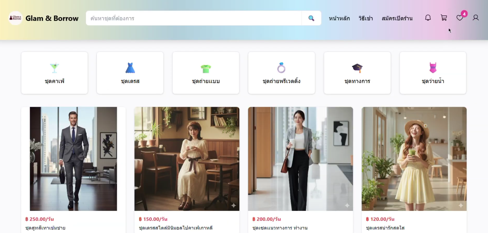
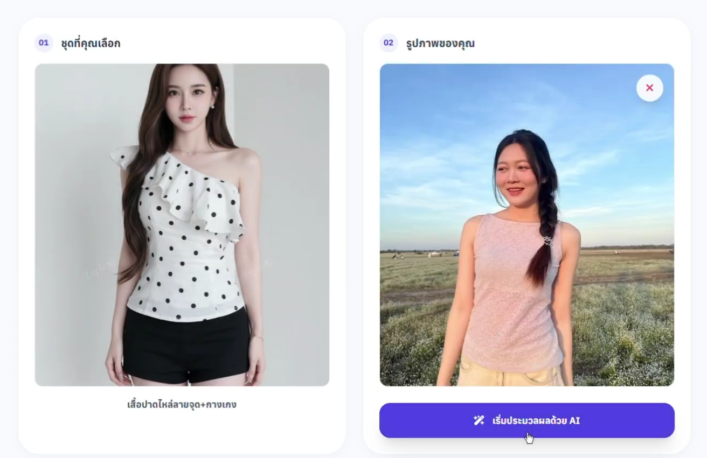
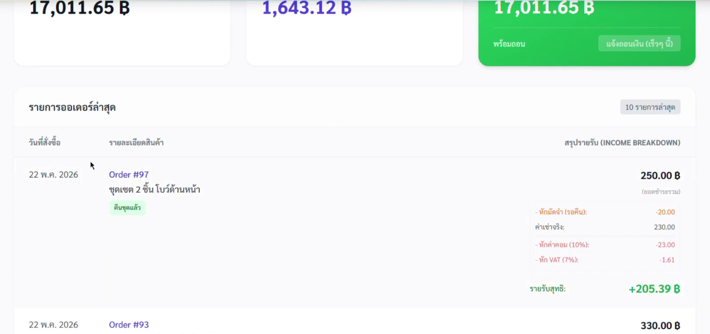
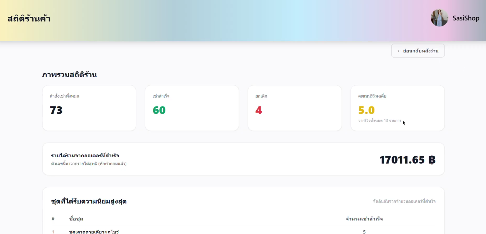
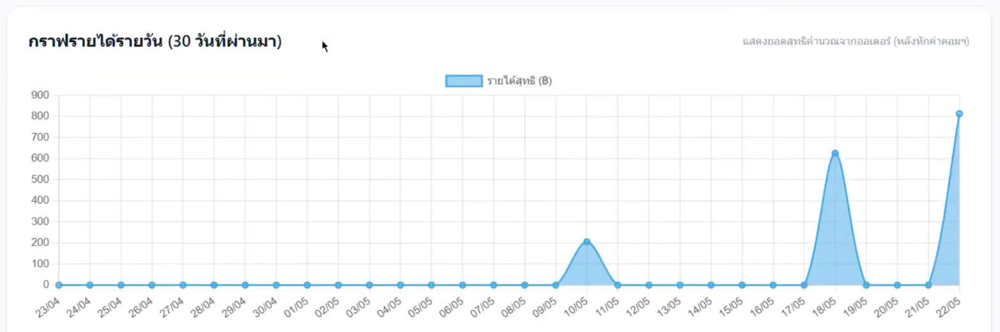
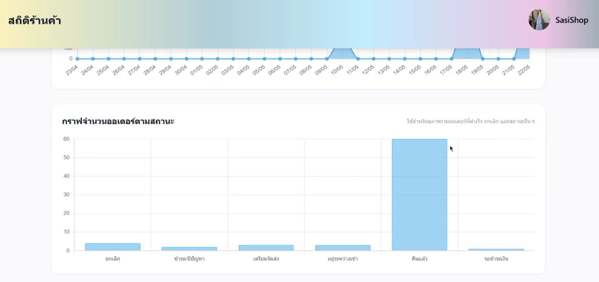
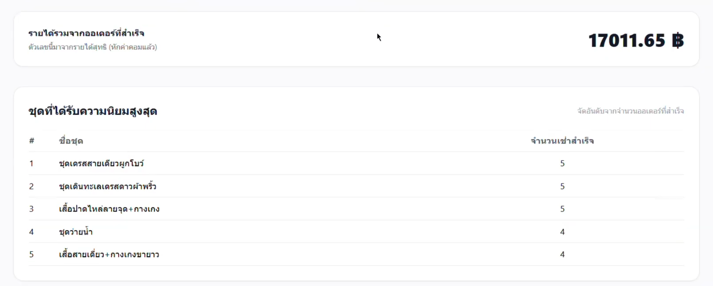
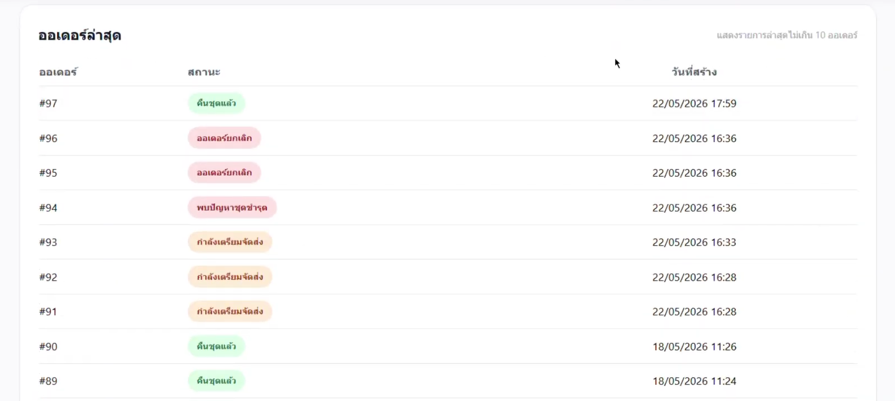
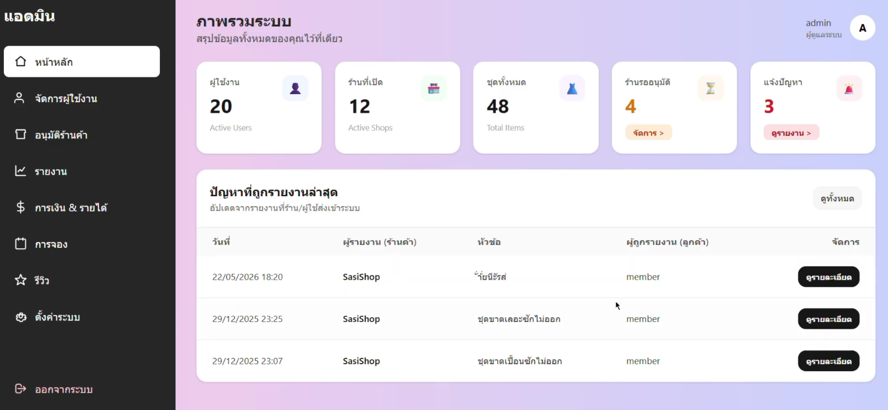
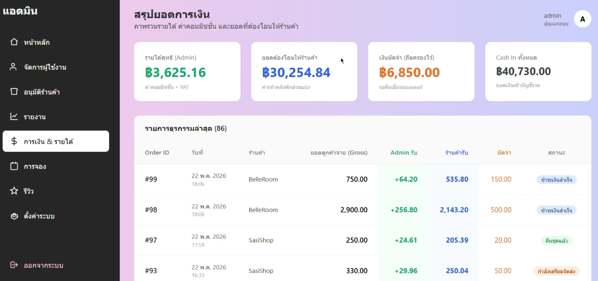

# 👗 Dress Rental Platform with AI Virtual Try-On

แพลตฟอร์มเช่าชุดออนไลน์แบบหลายร้านค้า (multi-vendor marketplace) พร้อมระบบ **AI ลองชุดเสมือนจริง** และแดชบอร์ดวิเคราะห์ยอดขาย
พัฒนาคนเดียวตั้งแต่ออกแบบฐานข้อมูล เขียน backend, หน้าเว็บ, ระบบชำระเงิน ไปจนถึงแดชบอร์ดสถิติ ใช้เป็น **Solo Capstone Project** ของสาขา Computer Science and Software Innovation (Data track) มหาวิทยาลัยอุบลราชธานี


-000000)

<!-- ================================================================= -->
<!-- 📌 จุดวางลิงก์วิดีโอ และ รูปที่ 1: หน้าแรกของเว็บ (Marketplace)       -->
<!-- วิธีใช้: แก้ลิงก์ YouTube ด้านล่าง และนำรูปหน้าแรกตั้งชื่อว่า home_marketplace.png ไปใส่ในโฟลเดอร์ screenshots/ -->
<!-- ================================================================= -->

### 🎥 [คลิกที่นี่เพื่อรับชมวิดีโอสาธิตการใช้งานระบบ (System Demo)](https://youtu.be/ed0zWFyF9-c?si=MKdzp_og-Gn-qzBo)



---

## สารบัญ

1. [ภาพรวมโปรเจกต์](#1-ภาพรวมโปรเจกต์)
2. [ผู้ใช้งาน 3 บทบาท](#2-ผู้ใช้งาน-3-บทบาท)
3. [ฟีเจอร์หลัก](#3-ฟีเจอร์หลัก)
4. [AI Virtual Try-On](#4-ai-virtual-try-on)
5. [ด้านข้อมูลและการวิเคราะห์ (Data & Analytics)](#5-ด้านข้อมูลและการวิเคราะห์-data--analytics)
6. [เทคโนโลยีที่ใช้](#6-เทคโนโลยีที่ใช้)
7. [โครงสร้างโปรเจกต์](#7-โครงสร้างโปรเจกต์)
8. [การติดตั้งและรันโปรเจกต์](#8-การติดตั้งและรันโปรเจกต์)
9. [การตั้งค่า Environment Variables](#9-การตั้งค่า-environment-variables)
10. [วิธีทดลองใช้งานระบบ](#10-วิธีทดลองใช้งานระบบ)
11. [Troubleshooting](#11-troubleshooting)
12. [แผนพัฒนาต่อ](#12-แผนพัฒนาต่อ)
13. [ผู้พัฒนา](#13-ผู้พัฒนา)

---

## 1. ภาพรวมโปรเจกต์

| หัวข้อ | รายละเอียด |
|---|---|
| ประเภทงาน | Solo capstone project (พัฒนาคนเดียวทั้งระบบ) |
| ปัญหาที่แก้ | ลูกค้าไม่แน่ใจว่าชุดที่เช่าจะใส่แล้วออกมาเป็นอย่างไร และร้านเช่าชุดรายเล็กขาดเครื่องมือจัดการออเดอร์ การเงิน และสถิติร้าน |
| แนวทางแก้ | รวมร้านเช่าชุดหลายร้านไว้บนแพลตฟอร์มเดียว ให้ลูกค้าลองชุดด้วย AI ก่อนเช่า และให้ร้านดูยอดขายได้เองผ่านแดชบอร์ด |
| ขนาดระบบ | 29 data models, 3 บทบาทผู้ใช้, 3 Django apps (`dress`, `backoffice`, `dress_rental`) |

---

## 2. ผู้ใช้งาน 3 บทบาท

| บทบาท | ทำอะไรได้ |
|---|---|
| **ลูกค้า (Customer)** | ค้นหาและกรองชุด, ลองชุดด้วย AI, ใส่ตะกร้า, เช่าและชำระเงิน, ติดตามสถานะการเช่า, รีวิวชุดและร้าน, แชทกับร้าน, แจ้งปัญหา (Report) |
| **ร้านค้า (Shop)** | เปิดร้านและรออนุมัติ, เพิ่ม/แก้ไข/เก็บถาวรชุด, ตั้งราคาและมัดจำ, จัดการคำสั่งเช่า, ตอบรีวิว, แชทกับลูกค้า, ดูสถิติร้านและรายได้, ขอถอนเงิน |
| **ผู้ดูแลระบบ (Admin)** | อนุมัติ/ปฏิเสธร้านค้า, จัดการผู้ใช้ (ระงับ/เปิดใช้/ลบ), ตรวจรีวิวและรายงานปัญหา, ดูภาพรวมการเงินแพลตฟอร์ม, ตั้งค่าค่าคอมมิชชันและค่าปรับ |

---

## 3. ฟีเจอร์หลัก

**ฝั่งลูกค้า**
- สมัครสมาชิก / เข้าสู่ระบบ / รีเซ็ตรหัสผ่าน / แก้ไขโปรไฟล์
- ค้นหาและดูรายละเอียดชุด, รายการโปรด (Favorites)
- ตะกร้าสินค้า (รวมหลายร้านในตะกร้าเดียว) และคำนวณราคารวมอัตโนมัติ
- ค่าเช่า + เงินมัดจำ + ค่าจัดส่ง (ร้านตั้งกฎค่าจัดส่งตามช่วงจำนวนชิ้นได้)
- ชำระเงิน **PromptPay ผ่าน Omise** และ **เก็บเงินปลายทาง (Cash on Delivery)**
- ติดตามสถานะคำสั่งเช่า, ใบเสร็จ, ประวัติการเช่า
- รีวิวพร้อมรูปภาพ, แจ้งชุดเสียหาย/ปัญหา (Damage Report)
- แชทกับร้านค้า (แนบรูปได้) และระบบแจ้งเตือน (Notification)

**ฝั่งร้านค้า**
- เปิดร้านพร้อมอัปโหลดเอกสารยืนยัน (บัตรประชาชน, สมุดบัญชี) เพื่อรอแอดมินอนุมัติ
- จัดการชุด: เพิ่ม แก้ไข เก็บถาวร (archive), หลายรูปต่อชุด, ราคาตามระยะเวลาเช่า (Price Template)
- ตั้งค่าร้าน: เปิด/ปิดร้าน, ข้อความปิดร้าน, เปิด/ปิดรีวิว, ช่องทางติดต่อ
- จัดการออเดอร์, ตรวจสภาพชุดหลังคืน, คิดค่าปรับคืนช้าอัตโนมัติ
- ธุรกรรมร้านและคำขอถอนเงิน (Withdrawal Request)
- **แดชบอร์ดสถิติร้าน**: รายได้ 30 วันล่าสุด, ชุดที่ถูกเช่ามากที่สุด, สถานะออเดอร์, คะแนนรีวิว

**ฝั่งผู้ดูแลระบบ (`/backoffice/`)**
- Dashboard ภาพรวมแพลตฟอร์ม
- อนุมัติ/ปฏิเสธร้านค้า (พร้อมระบุเหตุผล)
- จัดการผู้ใช้, การจอง, รีวิว, รายงานปัญหา
- แดชบอร์ดการเงิน (Finance) และหน้าตั้งค่าแพลตฟอร์ม

---

## 4. AI Virtual Try-On

ลูกค้าอัปโหลดรูปตัวเอง แล้วให้ AI สวมชุดที่เลือกให้ดูก่อนตัดสินใจเช่า

```
ลูกค้าอัปโหลดรูปตัวเอง ──► ระบบส่งรูปคน + รูปชุด ──► โมเดล IDM-VTON (Replicate API) ──► แสดงภาพผลลัพธ์
```

| รายการ | รายละเอียด |
|---|---|
| โมเดล | `cuuupid/idm-vton` (IDM-VTON) |
| ให้บริการผ่าน | [Replicate API](https://replicate.com/) |
| หน้าเว็บ | `/ai-try-on/<dress_id>/` |
| API endpoint | `/api/try-on/<dress_id>/` |
| ต้องมี | `REPLICATE_API_TOKEN` ในไฟล์ `.env` และติดตั้งแพ็กเกจ `replicate` |

> หมายเหตุ: ผลลัพธ์จาก AI เป็นภาพประกอบการตัดสินใจ อาจไม่ตรงกับสัดส่วนจริงของชุดทุกกรณี

<!-- ================================================================= -->
<!-- 📌 จุดวางรูปที่ 2: หน้าใช้งาน AI Virtual Try-On                     -->
<!-- วิธีใช้: นำรูปหน้า AI ลองชุด ตั้งชื่อว่า ai_try_on.png ไปใส่ในโฟลเดอร์ screenshots/ -->
<!-- ================================================================= -->

| อัปโหลดรูปคนและชุด (Input) | ผลลัพธ์จาก AI (Virtual Try-On) |
| :---: | :---: |
|  |  |

---

## 5. ด้านข้อมูลและการวิเคราะห์ (Data & Analytics)

ส่วนนี้สรุปงานด้านข้อมูลที่อยู่ในโปรเจกต์ เพื่อให้เห็นวิธีคิดตั้งแต่การออกแบบข้อมูลจนถึงการนำเสนอผล

### 5.1 การออกแบบฐานข้อมูล (PostgreSQL)

ออกแบบ schema ที่มีความสัมพันธ์ซับซ้อนทั้งหมด **29 data models** ผ่าน Django ORM และ **35 migrations** ที่เก็บประวัติการพัฒนา schema

| กลุ่มข้อมูล | Models |
|---|---|
| ร้านค้าและการตั้งค่า | `Shop`, `PlatformSettings`, `ShopCommission`, `ShippingRule`, `ShippingBracket` |
| สินค้า | `Category`, `Dress`, `DressImage`, `PriceTemplate`, `PriceTemplateItem`, `DressPriceOverride` |
| การเช่าและคำสั่งซื้อ | `Rental`, `RentalOrder`, `Order`, `OrderItem`, `CartItem`, `Payment` |
| การเงิน | `StoreTransaction`, `WithdrawalRequest` |
| ผู้ใช้และปฏิสัมพันธ์ | `UserProfile`, `Favorite`, `Review`, `ReviewImage`, `Notification` |
| แชทและรายงานปัญหา | `ShopChatThread`, `ShopChatMessage`, `Report`, `ReportAttachment`, `DamageReport` |

<!-- ================================================================= -->
<!-- 📌 จุดวางรูปที่ 3: รูป ER Diagram (ถ้ามี)                           -->
<!-- วิธีใช้: นำรูป ER Diagram ตั้งชื่อว่า er_diagram.png ไปใส่ในโฟลเดอร์ screenshots/ (ถ้าไม่มีรูปนี้ ลบบรรทัดด้านล่างออกได้) -->
<!-- ================================================================= -->


### 5.2 ตรรกะการคำนวณรายได้ (Revenue Logic)

ระบบคำนวณตัวเลขทางการเงินของแต่ละออเดอร์และเก็บค่าที่ใช้คำนวณไว้กับออเดอร์ (เช่น `applied_commission_rate`, `vat_amount`) เพื่อให้ย้อนตรวจสอบตัวเลขได้แม้ภายหลังมีการเปลี่ยนอัตราค่าคอมมิชชัน

```
ยอดที่ลูกค้าจ่าย   = ค่าเช่า + เงินมัดจำ + ค่าจัดส่ง
ค่าคอมมิชชัน       = ค่าเช่า × อัตราคอมมิชชัน (ค่าเริ่มต้น 10%)
VAT ของค่าคอมฯ     = ค่าคอมมิชชัน × 7%
รายได้ร้านค้า       = (ค่าเช่า − ค่าคอมมิชชัน − VAT ของค่าคอมฯ) + ค่าจัดส่ง + เงินมัดจำ
```

**ตัวอย่างการคำนวณ** (ค่าเช่า 1,000 บาท, มัดจำ 200 บาท, ค่าส่ง 50 บาท)

| รายการ | จำนวนเงิน (บาท) |
|---|---:|
| ลูกค้าจ่ายทั้งหมด | 1,250.00 |
| ค่าคอมมิชชัน 10% | 100.00 |
| VAT 7% ของค่าคอมฯ | 7.00 |
| **รายได้ที่ร้านได้รับ** | **1,143.00** |
| **รายได้แพลตฟอร์ม (คอมฯ + VAT)** | **107.00** |

**ค่าปรับคืนชุดช้า** ตั้งค่าได้จากหน้าตั้งค่าแพลตฟอร์ม: อัตราต่อวัน (เริ่มต้น 50 บาท/วัน), เพดานค่าปรับสูงสุด (เริ่มต้น 500 บาท), และช่วงผ่อนผันก่อนเริ่มคิดค่าปรับ (ชั่วโมง) และรองรับการกำหนดอัตราคอมมิชชันแยกรายร้านได้

<!-- ================================================================= -->
<!-- 📌 จุดวางรูปที่ 4: หน้าการเงินร้านค้า หรือ รายละเอียดการหักค่าคอมมิชชัน -->
<!-- วิธีใช้: นำรูปหน้าการเงินร้านค้า ตั้งชื่อว่า shop_finance.png ไปใส่ในโฟลเดอร์ screenshots/ -->
<!-- ================================================================= -->

| รายละเอียดการคำนวณรายรับ (Income Breakdown) |
| :---: |
|  |

### 5.3 แดชบอร์ดและรายงาน

| แดชบอร์ด | ผู้ใช้ | ข้อมูลที่แสดง |
|---|---|---|
| สถิติร้านค้า | ร้านค้า | รายได้ 30 วันล่าสุด, ชุดที่ถูกเช่ามากที่สุด, สถานะออเดอร์, คะแนนรีวิว |
| การเงินร้านค้า | ร้านค้า | ธุรกรรม, ยอดคงเหลือ, ประวัติการเงิน, คำขอถอนเงิน |
| Dashboard แพลตฟอร์ม | แอดมิน | ภาพรวมร้านค้า ผู้ใช้ และการจอง |
| การเงินแพลตฟอร์ม | แอดมิน | รายได้จากค่าคอมมิชชัน, VAT และธุรกรรมรวม |

การสรุปข้อมูลใช้ Django ORM aggregation (เช่น `Sum`, `TruncDate`) แล้วแสดงผลเป็นกราฟด้วย Chart.js ในหน้าสถิติร้านค้า ส่วนหน้าของแอดมินแสดงเป็นตารางสรุปตัวเลข

#### 📊 1) แดชบอร์ดสถิติร้านค้า (Shop Analytics Dashboard)
<!-- ✅ ใส่รูปทั้ง 5 รูปที่คุณเปลี่ยนชื่อแล้วให้เรียบร้อยครับ -->



| แนวโน้มรายได้สุทธิรายวัน (30 วันย้อนหลัง) | สัดส่วนจำนวนออเดอร์แยกตามสถานะ |
| :---: | :---: |
|  |  |

| อันดับชุดที่ได้รับความนิยมสูงสุด (Top 5 Dresses) | รายการติดตามสถานะออเดอร์ล่าสุด |
| :---: | :---: |
|  |  |

#### 🏛️ 2) แดชบอร์ดการเงินและภาพรวมแพลตฟอร์ม (Admin Backoffice Dashboard)

<!-- ================================================================= -->
<!-- 📌 จุดวางรูปที่ 5 และ 6: หน้า Dashboard แอดมิน และ การเงินแพลตฟอร์ม   -->
<!-- วิธีใช้: นำรูปหน้าแอดมินมาตั้งชื่อว่า admin_dashboard.png และ admin_finance.png แล้วใส่ในโฟลเดอร์ screenshots/ -->
<!-- ================================================================= -->

| ภาพรวมแพลตฟอร์ม (`/backoffice/`) | รายงานการเงินแพลตฟอร์ม (`/backoffice/finance/`) |
| :---: | :---: |
|  |  |

---

## 6. เทคโนโลยีที่ใช้

| ส่วนงาน | เทคโนโลยี |
|---|---|
| ภาษา | Python 3.11+, JavaScript, HTML/CSS |
| Backend | Django 5.2 |
| ฐานข้อมูล | PostgreSQL (ผ่านไดรเวอร์ `psycopg2`) |
| Frontend | Django Templates, TailwindCSS, JavaScript, Chart.js |
| ชำระเงิน | Omise (PromptPay) + Cash on Delivery |
| AI | IDM-VTON ผ่าน Replicate API |
| จัดการรูปภาพ | Pillow |
| ตั้งค่าระบบ | python-dotenv (`.env`) |
| เครื่องมือ | Git, GitHub |

---

## 7. โครงสร้างโปรเจกต์

```
DSSI-68-/
├── README.md
├── screenshots/                  # รูปภาพประกอบและกราฟแดชบอร์ดใน README
└── dress_rental/
    ├── manage.py
    ├── requirements.txt
    ├── env.example               # ตัวอย่างไฟล์ตั้งค่า (คัดลอกเป็น .env)
    ├── dress_rental/             # settings, urls หลักของโปรเจกต์
    ├── dress/                    # แอปหลัก: ลูกค้า + ร้านค้า
    │   ├── models.py             # 28 models (ระบบเช่า การเงิน แชท รีวิว)
    │   ├── views.py              # ตรรกะเช่า ตะกร้า ชำระเงิน AI try-on สถิติร้าน
    │   ├── urls.py
    │   ├── report/               # ระบบรายงานปัญหาและรายงานความเสียหาย
    │   ├── notifications/        # ระบบแจ้งเตือนร้านค้า
    │   ├── migrations/           # ประวัติ schema (35 ไฟล์)
    │   └── templates/            # หน้าเว็บทั้งหมด
    ├── backoffice/               # แอปผู้ดูแลระบบ (custom admin)
    └── static/                   # CSS และไฟล์ static
```

---

## 8. การติดตั้งและรันโปรเจกต์

คู่มือนี้สำหรับรันในโหมดพัฒนา (Development)

### 8.1 สิ่งที่ต้องติดตั้งก่อน

- Python 3.11 ขึ้นไป
- PostgreSQL
- Git

ตรวจสอบเวอร์ชัน

```bash
python --version
psql --version
git --version
```

> บน macOS / Linux ใช้ `python3` แทน `python`

### 8.2 Clone โปรเจกต์

```bash
git clone [https://github.com/Tsaiwimon/DSSI-68-.git](https://github.com/Tsaiwimon/DSSI-68-.git)
cd DSSI-68-/dress_rental
```

### 8.3 สร้าง Virtual Environment

**Windows**
```bash
python -m venv venv
venv\Scripts\activate
```

**macOS / Linux**
```bash
python3 -m venv venv
source venv/bin/activate
```

### 8.4 ติดตั้ง Dependencies

```bash
pip install --upgrade pip
pip install -r requirements.txt
pip install replicate
```

### 8.5 สร้างฐานข้อมูล PostgreSQL

สร้างฐานข้อมูลชื่อ `dress_rental`

```bash
psql -U postgres -c "CREATE DATABASE dress_rental;"
```

จากนั้นเปิดไฟล์ `dress_rental/settings.py` ตรวจส่วน `DATABASES` ให้ `USER` และ `PASSWORD` ตรงกับ PostgreSQL ในเครื่องของคุณ (ค่า `HOST` คือ `localhost`, `PORT` คือ `5432`)

### 8.6 ตั้งค่าไฟล์ `.env`

```bash
# macOS / Linux
cp env.example .env

# Windows
copy env.example .env
```

แล้วแก้ค่าในไฟล์ `.env` ตามหัวข้อ [9. การตั้งค่า Environment Variables](#9-การตั้งค่า-environment-variables)

### 8.7 สร้างตารางในฐานข้อมูล

```bash
python manage.py migrate
```

### 8.8 สร้างผู้ดูแลระบบ (Superuser)

```bash
python manage.py createsuperuser
```

กรอก Username, Email (ไม่บังคับ) และ Password

### 8.9 รันเซิร์ฟเวอร์

```bash
python manage.py runserver
```

| หน้า | ลิงก์ |
|---|---|
| หน้าเว็บหลัก | http://127.0.0.1:8000/ |
| Django Admin | http://127.0.0.1:8000/admin/ |
| Back-Office (ผู้ดูแลระบบ) | http://127.0.0.1:8000/backoffice/ |

---

## 9. การตั้งค่า Environment Variables

ไฟล์ `.env` ต้องอยู่ในโฟลเดอร์ `dress_rental/` (ระดับเดียวกับ `manage.py`) และ **ห้ามอัปโหลดขึ้น GitHub**

```env
# Omise (ใช้ Test Mode)
OMISE_PUBLIC_KEY=pkey_test_xxxxxxxxxxxxxxxx
OMISE_SECRET_KEY=skey_test_xxxxxxxxxxxxxxxx
OMISE_CURRENCY=thb

# Replicate (AI Virtual Try-On)
REPLICATE_API_TOKEN=r8_xxxxxxxxxxxxxxxx
```

| ตัวแปร | ใช้ทำอะไร | ขอได้จาก |
|---|---|---|
| `OMISE_PUBLIC_KEY` | คีย์สาธารณะสำหรับระบบชำระเงิน | Omise Dashboard → Settings → API Keys |
| `OMISE_SECRET_KEY` | คีย์ลับสำหรับสร้างรายการชำระเงิน | Omise Dashboard → Settings → API Keys |
| `OMISE_CURRENCY` | สกุลเงิน (ค่าเริ่มต้น `thb`) | - |
| `REPLICATE_API_TOKEN` | เรียกใช้โมเดล AI ลองชุด | Replicate → Account → API tokens |

> โปรเจกต์นี้ใช้ **Test Mode** ของ Omise ไม่มีการตัดเงินจริง หากไม่ได้ตั้งค่าคีย์ ระบบชำระเงิน PromptPay และ AI ลองชุดจะใช้งานไม่ได้ แต่ส่วนอื่นของเว็บยังทำงานได้

---

## 10. วิธีทดลองใช้งานระบบ

ทดลองครบวงจรได้ตามลำดับนี้

1. **สมัครสมาชิกลูกค้า** ที่หน้าสมัคร 2 บัญชี (บัญชีหนึ่งเป็นลูกค้า อีกบัญชีใช้เปิดร้าน)
2. **เปิดร้าน** ด้วยบัญชีที่สอง กรอกข้อมูลร้านและอัปโหลดเอกสาร ระบบจะแสดงสถานะ "รออนุมัติ"
3. **อนุมัติร้าน** ล็อกอินด้วย superuser แล้วไปที่ `/backoffice/shops/pending/` เพื่ออนุมัติ
4. **เพิ่มชุด** ในร้านที่อนุมัติแล้ว (ใส่รูป ราคา มัดจำ)
5. **เช่าชุด** ด้วยบัญชีลูกค้า: เลือกชุด → ลอง AI → ใส่ตะกร้า → ชำระเงิน
6. **ดูผลลัพธ์** ฝั่งร้านที่หน้าสถิติและการเงิน ฝั่งแอดมินที่ `/backoffice/finance/`

---

## 11. Troubleshooting

| ปัญหา | วิธีแก้ |
|---|---|
| `could not connect to server` / `password authentication failed` | เช็กว่า PostgreSQL เปิดอยู่ และ `USER`/`PASSWORD` ใน `settings.py` ถูกต้อง |
| `database "dress_rental" does not exist` | สร้างฐานข้อมูลด้วย `CREATE DATABASE dress_rental;` |
| `ModuleNotFoundError: No module named 'replicate'` | รัน `pip install replicate` |
| `migrate` ไม่ผ่าน | เช็กว่า activate virtual environment แล้ว และอยู่ในโฟลเดอร์ `dress_rental/` ที่มี `manage.py` |
| AI ลองชุดไม่ทำงาน | เช็กว่ามี `REPLICATE_API_TOKEN` ใน `.env` และบัญชี Replicate มีเครดิต |
| PromptPay ไม่ขึ้น QR | เช็กค่า Omise key (ต้องเป็น Test Mode `pkey_test_` / `skey_test_`) |
| รูปไม่แสดง | ต้องรันด้วย `DEBUG = True` และมีโฟลเดอร์ `media/` (ระบบสร้างให้เมื่ออัปโหลดรูปแรก) |
| Port 8000 ถูกใช้งาน | `python manage.py runserver 8080` |

---

## 12. แผนพัฒนาต่อ

- ย้ายค่าตั้งค่าที่เป็นความลับทั้งหมด (รหัสผ่านฐานข้อมูล, `SECRET_KEY`) ไปไว้ใน `.env`
- เพิ่ม automated tests สำหรับตรรกะคำนวณรายได้และค่าปรับ
- Deploy ขึ้น cloud พร้อมตั้ง `DEBUG = False`
- เพิ่มกราฟวิเคราะห์เชิงลึก เช่น แนวโน้มรายเดือน ช่วงเวลาที่มีการเช่าสูง และพฤติกรรมลูกค้าซื้อซ้ำ
- เชื่อมต่อข้อมูลกับเครื่องมือ BI เช่น Power BI / Looker Studio

---

## 13. ผู้พัฒนา

**Sasiwimon Kongphon**
นักศึกษาปี 4 สาขา Computer Science and Software Innovation (Data track) มหาวิทยาลัยอุบลราชธานี

- 📧 sasiwimon.ko.66@ubu.ac.th
- 💻 GitHub: https://github.com/Tsaiwimon/DSSI-68-
